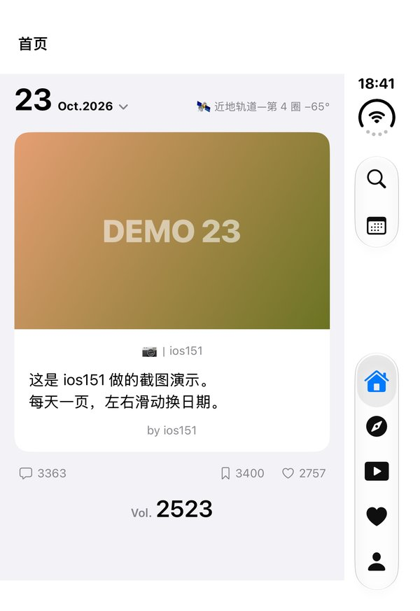
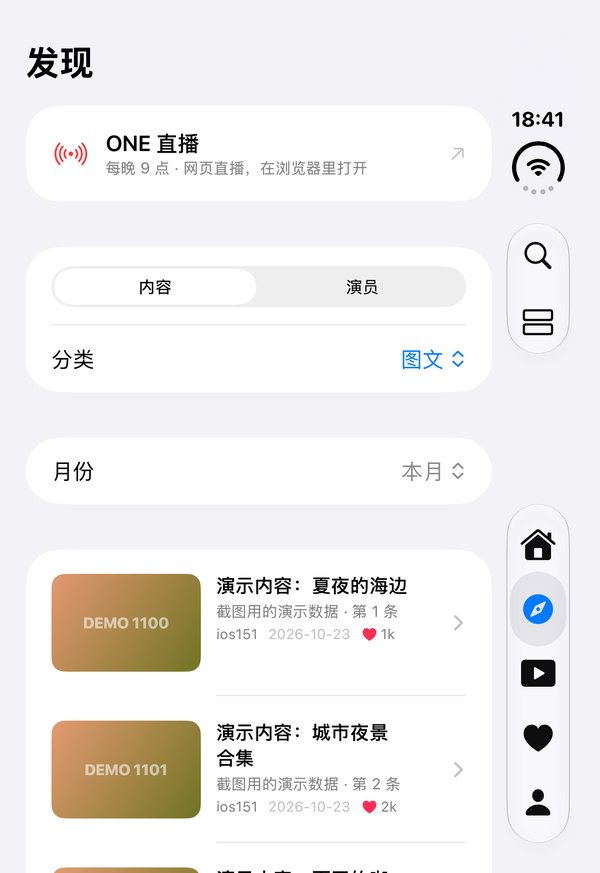
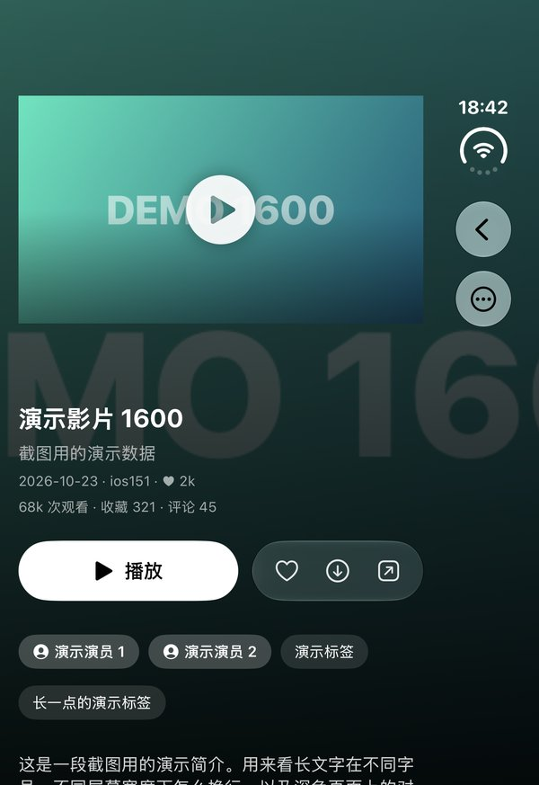
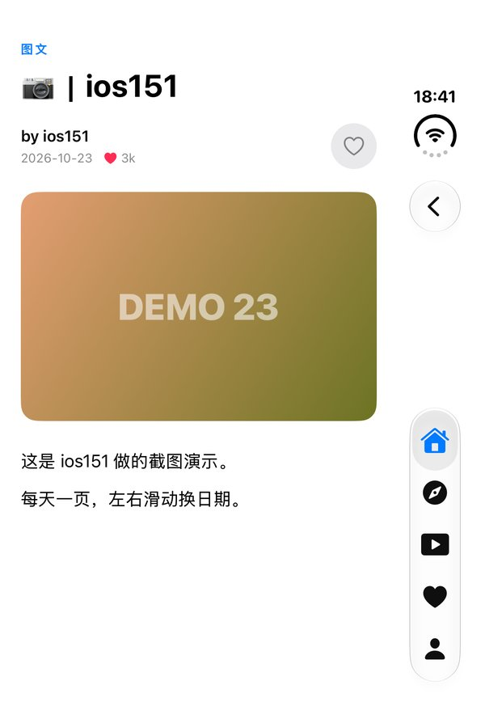
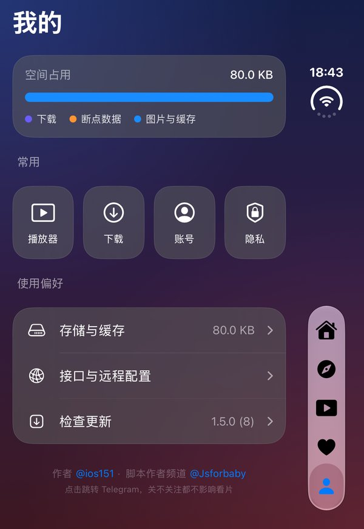

# One · 安装包

这个仓库只用来发布 **One** 的未签名 IPA，**不含源码**。

## 下载与安装

1. 打开 [Releases](https://github.com/ios151/One-releases/releases/latest)，下载最新的 `One-unsigned.ipa`
2. 安装包是**未签名**的，不能直接装：用自己的证书，或者 SideStore / AltStore 这类工具自签后安装
3. 装好之后 App 会每天自动检查一次新版本，有新版会在输入口令后提示，点「去下载」回到这里下载新的安装包重新安装即可

## 截图

iPhone Duo（合上时的外屏，系统栏竖排在右侧）。截图里的内容是演示数据。

  
  
  
  
  

## 说明

- 最低系统：iOS 16；iPhone / iPad 通用，适配 iPhone Duo
- 每个版本的更新内容见对应 Release 的说明，也会显示在 App 的更新提示里
